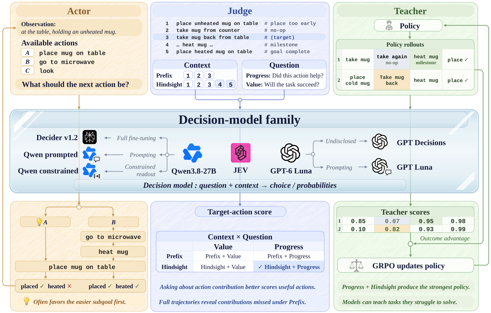

<h1 align="center">Actor, Judge, or Teacher?</h1>
<h3 align="center">Understanding Decision Models in Long-Horizon Agents</h3>

<p align="center">
  <a href="#abstract">Abstract</a> ·
  <a href="#overview">Overview</a> ·
  <a href="#findings">Findings</a> ·
  <a href="#main-takeaways">Main Takeaways</a> ·
  <a href="#installation">Installation</a> ·
  <a href="#training">Training</a>
</p>

<a id="abstract"></a>

## 📝 Abstract

Decision models answer a question with a typed output, such as a choice among options with a probability for each, so one model can choose an agent's actions, judge actions already taken, or score every action to teach a policy with reinforcement learning. They have been evaluated mainly as actors, where they often fail. We study three decision models and three general LLMs given the same questions in all three roles on ALFWorld and WebShop. Our results suggest that a decision model that acts poorly can still teach well, because judging an action after the episode ends reveals the consequences that acting must anticipate. As actors, all six models are pulled away from a subgoal that must come first by an easier one. As judges that see the whole trajectory and are asked whether each action helped, the same models credit the actions that repair such mistakes, whereas asking whether the task will succeed gives every action nearly the same score. Used this way as a teacher, JEV raises a Qwen2.5-1.5B-Instruct policy over GRPO from 72.8% to 82.9% success on ALFWorld and from 56.8% to 71.4% on WebShop, with the largest gains on the tasks that JEV rarely completes as an actor.

<a id="overview"></a>

## 🔎 Overview

We study decision models in three roles, with different questions, available context, and uses of their answers:

- **Actor:** selects the next action from valid candidates using the goal, interaction history, and current observation.
- **Judge:** scores recorded actions, varying what it is asked—whether the task will succeed (**Value**) or whether the action helped achieve the goal (**Progress**)—and what it sees: the trajectory up to the action (**Prefix**) or the whole trajectory (**Hindsight**).
- **Teacher:** scores actions in rollouts from the policy being trained. These scores are centered within each rollout group and added to the GRPO outcome advantage. The Teacher stays fixed during training and is not queried at test time.

<p align="center">
  
</p>

<a id="findings"></a>

## 📊 Findings

Our analyses follow the same decision models from choosing actions, to judging recorded actions, to teaching a policy:

1. **Actors struggle to coordinate dependent subgoals.** All six models succeed less often when subgoals must be completed in order. Removing the easier subgoal from the goal shifts their choices toward the step that must come first, showing that they can identify that step. Dependency hints and ordering examples do not consistently prevent the error.

2. **The same models give overlooked actions more credit as Judges.** On the actions examined in our Actor-to-Judge experiment, all six models assign higher mean contribution scores when they see the whole trajectory. This raises two questions: do they simply score every action highly, and what does the additional context reveal?

3. **The question determines whether Judges distinguish action contributions.** With the whole trajectory held fixed, asking whether the task will succeed produces similar scores across action types. Asking whether each action helped achieve the goal yields clearer distinctions; for JEV, the within-trajectory score gap between milestone and no-op actions increases from 0.05 to 0.36.

4. **The whole trajectory reveals contributions that the action history alone can obscure.** As more of the trajectory becomes visible, action rankings move further from their initial ordering. In our case study, JEV initially favors the easier subgoal, mirroring the Actor's error. Seeing the later heating steps increases its score for opening the microwave, revealing how that earlier action supports the subgoal that must be completed first.

5. **These judgments can teach a policy to solve tasks the Teacher struggles to solve itself.** Using Hindsight + Progress scores during training raises the 1.5B policy's success from 72.8% to 82.9% on ALFWorld and from 56.8% to 71.4% on WebShop. The advantage is largest on tasks with dependent subgoals: the trained policy succeeds on 86.8%, although JEV succeeds on only 14.7% as an Actor. The Teacher remains fixed and is not queried at test time.

<a id="main-takeaways"></a>

## 💡 Main Takeaways for Using Decision Models in Agents

- **Actors know the required step but are drawn to the easier one.** Actors choose the step that must come first when it is the only subgoal in the goal, and general reminders do not prevent the error when an easier subgoal is present. When a decision model must act, restructuring the goal, for example into ordered subgoals, is more promising than merely adding instructions to the prompt.
- **The question sets the granularity of the signal.** A question about the eventual outcome gives similar scores to all actions in a trajectory and largely repeats the outcome reward, while a question about each action's contribution separates actions within a trajectory.
- **Hindsight judgments target the actor's own failure.** Seeing the whole trajectory helps Judges recognize the contributions of actions toward the subgoal that needs to be met first, which Actors may overlook in favor of an easier subgoal. Decision models are therefore best used to score actions after an episode ends, as in RL training, and are less suited to filtering actions online, where only the prefix is available.
- **Judges can be screened before training.** The Judge measures on recorded trajectories identified the question and context that trained the best policy, at a small fraction of the cost of an RL run. Compare candidate judges and questions this way first, and choose by judging quality, not acting ability.
- **Step-level supervision becomes affordable.** Decision models judge more accurately and at lower cost than prompted general LLMs, and the Teacher is not needed at test time. Scoring every action during RL training is therefore practical, and can let a small policy outperform a larger one trained with outcome rewards alone.

<a id="repository-layout"></a>

## 🗂️ Repository Layout

```text
decision_model/
  actor.py                # Candidate-action selection
  judge.py                # Action scoring on recorded trajectories
  runner.py               # Actor/environment interaction
  models/                 # Decisions API, Prompted, and Constrained clients
  prompts/                # Dataset adapters, contexts, and questions
  advantage/              # Step-level advantages from model scores
  training/               # Teacher integration with policy training
examples/decision_model/
  run_alfworld.sh          # ALFWorld Teacher training
  run_webshop.sh           # WebShop Teacher training
  prepare_data.py         # Training data preparation
```

Everything else is inherited from the upstream `verl-agent` framework or kept as baseline/reproduction utilities.

<a id="installation"></a>

## 📦 Installation

Use separate environments for the base framework and WebShop, which requires Python ≤ 3.10.

### 1. Base Framework

```bash
conda create -n verl-agent python==3.12 -y
conda activate verl-agent

pip3 install torch==2.6.0 --index-url https://download.pytorch.org/whl/cu124
pip3 install flash-attn==2.7.4.post1 --no-build-isolation
pip3 install -e .
pip3 install vllm==0.8.5
```

### 2. ALFWorld

```bash
pip3 install gymnasium==0.29.1
pip3 install stable-baselines3==2.6.0
pip install alfworld
pip install vllm==0.8.5

alfworld-download -f
```

### 3. WebShop

```bash
conda create -n verl-agent-webshop python==3.10 -y
conda activate verl-agent-webshop

(cd agent_system/environments/env_package/webshop/webshop && bash setup.sh -d all)

pip3 install torch==2.6.0 --index-url https://download.pytorch.org/whl/cu124
pip3 install flash-attn==2.7.4.post1 --no-build-isolation
pip3 install -e .
pip3 install vllm==0.8.2
```

<a id="training"></a>

## 🚀 Training

Training scripts for **Qwen2.5-1.5B-Instruct** are provided in [`examples/decision_model/`](examples/decision_model/):

```bash
bash examples/decision_model/run_alfworld.sh    # ALFWorld
bash examples/decision_model/run_webshop.sh     # WebShop
```

<a id="acknowledgments"></a>

## 🙏 Acknowledgments

Our implementation uses [verl-agent / GiGPO](https://github.com/langfengQ/verl-agent) and its underlying [veRL](https://github.com/volcengine/verl) framework. We are grateful to their developers and to the teams behind [ALFWorld](https://github.com/alfworld/alfworld) and [WebShop](https://github.com/princeton-nlp/WebShop) for releasing their work.

Released under the [Apache License 2.0](LICENSE).
