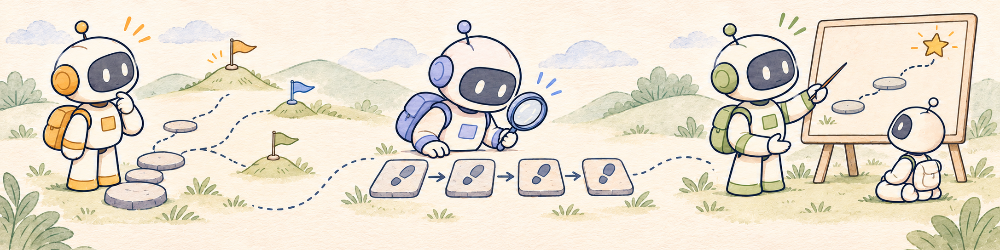

<h1 align="center">
  
</h1>
<h3 align="center">Understanding Decision Models in Long-Horizon Agents</h3>

<p align="center">
  
</p>

<p align="center">
  Haochen Liu<sup>1,*</sup>, Qianhao Zhu<sup>1,*</sup>, Zixuan Wang<sup>1,*</sup>, Dingming Li<sup>1</sup>, Tongbo Chen<sup>1</sup><br>
  Peng Qiu<sup>2</sup>, Yingqi Qu<sup>2</sup>, Weiming Lu<sup>1</sup>, Jun Xiao<sup>1</sup>, Yongliang Shen<sup>1,†</sup>
</p>

<p align="center">
  <sup>1</sup>Zhejiang University &nbsp;&nbsp; <sup>2</sup>Baidu<br>
  <sup>*</sup>Equal contribution &nbsp;&nbsp; <sup>†</sup>Corresponding author
</p>

<p align="center">
  <a href="https://zjureal.com/decision-agents/">
    
  </a>
  <a href="https://arxiv.org/abs/2611.17167">
    
  </a>
  <a href="https://huggingface.co/papers/2611.17167">
    
  </a>
</p>

<p align="center">
  <a href="#abstract">Abstract</a> ·
  <a href="#overview">Overview</a> ·
  <a href="#findings">Findings</a> ·
  <a href="#main-takeaways">Main Takeaways</a> ·
  <a href="#installation">Installation</a> ·
  <a href="#training">Training</a> ·
  <a href="#citation">Citation</a>
</p>

<a id="abstract"></a>

## 📝 Abstract

Decision models answer a question with a typed output, such as a choice among options with a probability for each, so one model can choose an agent's actions, judge actions already taken, or score every action to teach a policy with reinforcement learning. They have been evaluated mainly as actors, where they often fail. We study three decision models and three general LLMs given the same questions in all three roles on ALFWorld and WebShop. Our results suggest that a decision model that acts poorly can still teach well, because judging an action after the episode ends reveals the consequences that acting must anticipate. As actors, all six models are pulled away from a subgoal that must come first by an easier one. As judges that see the whole trajectory and are asked whether each action helped, the same models credit the actions that repair such mistakes, whereas asking whether the task will succeed gives every action nearly the same score. Used this way as a teacher, JEV raises a Qwen2.5-1.5B-Instruct policy over GRPO from 72.8% to 82.9% success on ALFWorld and from 56.8% to 71.4% on WebShop, with the largest gains on the tasks that JEV rarely completes as an actor.

<a id="overview"></a>

## 🔎 Overview

We study decision models in three roles, with different questions, available context, and uses of their answers:

- **Actor:** selects the next action from valid candidates using the goal, interaction history, and current observation.
- **Judge:** scores recorded actions for task success (**Value**) or goal contribution (**Progress**), using the trajectory up to the action (**Prefix**) or the full trajectory (**Hindsight**).
- **Teacher:** scores policy rollouts; group-centered action scores augment the GRPO outcome advantage. The Teacher remains fixed during training and is not queried at test time.

<p align="center">
  
</p>

<a id="findings"></a>

## 📊 Findings

Our three main findings follow decision models from acting, to judging, to teaching:

1. **Actor.** As Actors, decision models struggle with dependent subgoals: an easier subgoal draws them away from the subgoal that must be met first.

2. **Judge.** The same models recognize contributions they overlook as Actors. This depends on their context and question. Seeing the whole trajectory reveals how earlier actions contribute to later goal completion. Asking whether each action helped achieve the goal distinguishes their contributions more clearly than asking whether the task will succeed, which gives similar scores to actions within a trajectory.

3. **Teacher.** The judgments that best distinguish action contributions also provide the best supervision for policy learning. Scoring whether each action helped achieve the goal after seeing the whole trajectory produces the strongest policies, with the largest gains on tasks that the Actor struggles to complete. The trained policies outperform their teacher, especially on tasks it rarely completes as an Actor.

<a id="main-takeaways"></a>

## 💡 Main Takeaways for Using Decision Models in Agents

- **Actors know the required step but are drawn to the easier one.** Actors choose the step that must come first when it is the only subgoal in the goal, and general reminders do not prevent the error when an easier subgoal is present. When a decision model must act, restructuring the goal, for example into ordered subgoals, is more promising than merely adding instructions to the prompt.
- **The question sets the granularity of the signal.** A question about the eventual outcome gives similar scores to all actions in a trajectory and largely repeats the outcome reward, while a question about each action's contribution separates actions within a trajectory.
- **Hindsight judgments target the actor's own failure.** Seeing the whole trajectory helps Judges recognize the contributions of actions toward the subgoal that needs to be met first, which Actors may overlook in favor of an easier subgoal. Decision models are therefore best used to score actions after an episode ends, as in RL training, and are less suited to filtering actions online, where only the prefix is available.
- **Judges can be screened before training.** The Judge measures on recorded trajectories identified the question and context that trained the best policy, at a small fraction of the cost of an RL run. Compare candidate judges and questions this way first, and choose by judging quality, not acting ability.
- **Step-level supervision becomes affordable.** Decision models judge more accurately and at lower cost than prompted general LLMs, and the Teacher is not needed at test time. Scoring every action during RL training is therefore practical, and can let a small policy outperform a larger one trained with outcome rewards alone.

<a id="repository-layout"></a>

## 🗂️ Repository Layout

```text
decision_model/
  actor.py                # Candidate-action selection
  judge.py                # Action scoring on recorded trajectories
  runner.py               # Actor/environment interaction
  models/                 # Decisions API, Prompted, and Constrained clients
  prompts/                # Dataset adapters, contexts, and questions
  advantage/              # Step-level advantages from model scores
  training/               # Teacher integration with policy training
examples/decision_model/
  run_alfworld.sh          # ALFWorld Teacher training
  run_webshop.sh           # WebShop Teacher training
  prepare_data.py         # Training data preparation
```

Everything else is inherited from the upstream `verl-agent` framework or kept as baseline/reproduction utilities.

<a id="installation"></a>

## 📦 Installation

Use separate environments for the base framework and WebShop, which requires Python ≤ 3.10.

### 1. Base Framework

```bash
conda create -n verl-agent python==3.12 -y
conda activate verl-agent

pip3 install torch==2.6.0 --index-url https://download.pytorch.org/whl/cu124
pip3 install flash-attn==2.7.4.post1 --no-build-isolation
pip3 install -e .
pip3 install vllm==0.8.5
```

### 2. ALFWorld

```bash
pip3 install gymnasium==0.29.1
pip3 install stable-baselines3==2.6.0
pip install alfworld
pip install vllm==0.8.5

alfworld-download -f
```

### 3. WebShop

```bash
conda create -n verl-agent-webshop python==3.10 -y
conda activate verl-agent-webshop

(cd agent_system/environments/env_package/webshop/webshop && bash setup.sh -d all)

pip3 install torch==2.6.0 --index-url https://download.pytorch.org/whl/cu124
pip3 install flash-attn==2.7.4.post1 --no-build-isolation
pip3 install -e .
pip3 install vllm==0.8.2
```

<a id="training"></a>

## 🚀 Training

Training scripts for **Qwen2.5-1.5B-Instruct** are provided in [`examples/decision_model/`](examples/decision_model/):

```bash
bash examples/decision_model/run_alfworld.sh    # ALFWorld
bash examples/decision_model/run_webshop.sh     # WebShop
```

<a id="acknowledgments"></a>

## 🙏 Acknowledgments

Our implementation uses [verl-agent / GiGPO](https://github.com/langfengQ/verl-agent) and its underlying [veRL](https://github.com/volcengine/verl) framework. We are grateful to their developers and to the teams behind [ALFWorld](https://github.com/alfworld/alfworld) and [WebShop](https://github.com/princeton-nlp/WebShop) for releasing their work.

Released under the [Apache License 2.0](LICENSE).

<a id="citation"></a>

## ⭐ Citation

If you find this project useful, please cite our paper:

```bibtex
@misc{liu2026actorjudgeteacherunderstanding,
  title={Actor, Judge, or Teacher? Understanding Decision Models in Long-Horizon Agents},
  author={Haochen Liu and Qianhao Zhu and Zixuan Wang and Dingming Li and Tongbo Chen and Peng Qiu and Yingqi Qu and Weiming Lu and Jun Xiao and Yongliang Shen},
  year={2026},
  eprint={2611.17167},
  archivePrefix={arXiv},
  primaryClass={cs.AI},
  url={https://arxiv.org/abs/2611.17167},
}
```
